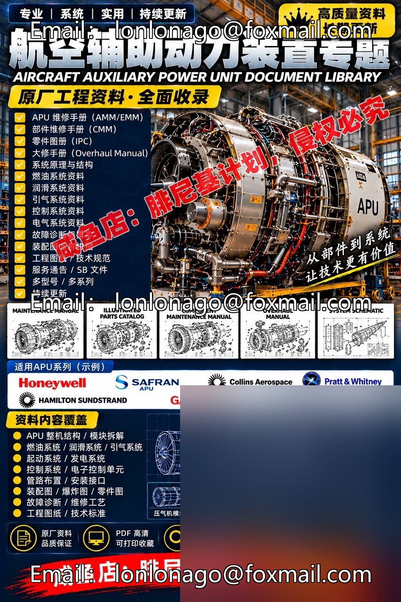

# APU maintenance manual and part drawings

## Body

APU Maintenance Manual and Part Drawing Book ✈️ [Aviation Auxiliary Power Unit Special] APU ENGINEERING DOCUMENT LIBRARY

Aviation engineering technical materials organization | APU maintenance manual | part drawing book | system principle diagram | engineering drawing

Focus on engineering technical materials related to auxiliary power units (APU), organize and categorize them around directions such as equipment structure, module composition, maintenance and repair, part decomposition, system principles, and fault diagnosis, suitable for research, mechanical structure analysis, component recognition, and reference for digital modeling.

1. Type of data

✅ APU Maintenance Manual | Auxiliary Power Unit Maintenance Manual
✅ APU AMM / EMM | Maintenance and Engine Maintenance Manual
✅ CMM Component Maintenance Manual | Component Maintenance Manual
✅ IPC Illustrated Parts Catalog | Illustrated Parts Catalog
✅ IPB Illustrated Parts Breakdown | Parts Breakdown Manual
✅ Overhaul Manual | Major Overhaul Manual
✅ Service Manual | Maintenance Service Manual

✅ System Description｜System principles and structure explanation
✅ Troubleshooting Manual｜Troubleshooting manual
✅ Assembly Drawing｜Assembly drawing
✅ Exploded View｜Part exploded view
✅ Hydraulic / Fuel / Lubrication System｜Hydraulic, fuel, and lubrication system materials
✅ Electrical Wiring Diagram｜Electrical wiring diagram
✅ Service Bulletin / Technical Publication｜Service bulletin and technical document

2. Content of key materials

• APU overall structure and module division
• Pneumatic engine, turbine, and rotor components
• Combustion system and fuel control
• Lubrication system, slip pump, and tubing
• Air intake system and air line components
• Startup system and electrical control
• Electronic control unit and sensors
• Accessory gear box and transmission parts
• Piping layout, connection interface, and installation structure
• Part numbering, assembly relationship, and exploded view
• Maintenance process, inspection standards, and fault isolation

3. Key retrieval directions

Public technical materials of Honeywell APU, Safran APU, Collins Aerospace APU, Hamilton Sundstrand APU, Garrett APU, and other auxiliary power unit manufacturers.

4. Professional retrieval keywords

Aircraft APU Manual, Auxiliary Power Unit Manual, APU Maintenance Manual, APU Overhaul Manual, APU IPC, APU Parts Catalog, APU CMM, APU Component Manual, APU Illustrated Parts Breakdown, APU Exploded View, APU Assembly Drawing, APU System Schematic, APU Fuel Sys

tem, APU Lubrication System, APU Bleed Air System, APU Starter, APU Generator, APU Gearbox, APU Troubleshooting, APU Repair Manual, APU Service Bulletin, Aircraft Auxiliary Power Unit Engineering.

5. Special features

Classified retrieval based on specific equipment model, manufacturer, document type, and version, focusing on technical materials with clear model identification, part breakdown diagrams, assembly relationships, and system engineering information.

Suitable for aviation engineering technical personnel, mechanical engineering researchers, equipment maintenance technical researchers, and enthusiasts of engineering digital modeling.

Specific model numbers, file types, versions, page counts, and the scope of items that can be provided shall be based on the actual material list; welcome to provide equipment model or matching inquiry based on the existing material cover.

Fish Shop: Phrygian plan, infringement shall be investigated and penalized

The APU maintenance manual and parts catalog cover the aviation auxiliary power unit theme, including maintenance manuals, part catalogs, system schematics and various engineering drawings.

<!-- AI_ENRICHED -->

## Images

## Payment

Here is a pay link on Stripe ( https://buy.stripe.com/3cs8yP7sY87d0vu9AB ). Please contact me lonlonago@foxmail.com after funding $89, and I will send you a complete data files , thank you!

